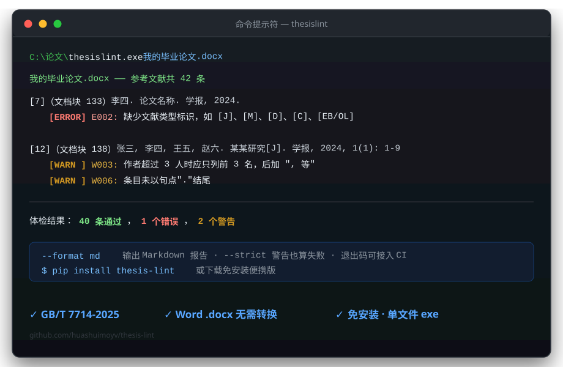
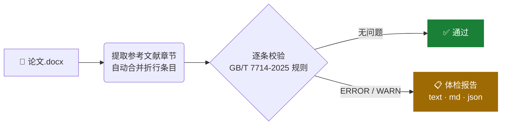

<div align="center">

# 🎓 thesis-lint

_毕业论文「国标体检」工具_

**让每一篇 Word 论文的参考文献，都经得起 GB/T 7714-2025 的检验**

[](https://github.com/huashuimoyv/thesis-lint/releases)
[](./actions)
[](./LICENSE)
[](pyproject.toml)



**[🌐 在线版（免下载，浏览器直接用）](https://huashuimoyv.github.io/thesis-lint/)**
·
[⬇️ 下载免安装便携版](https://github.com/huashuimoyv/thesis-lint/releases/latest)
·
[快速上手](#-快速上手)
·
[规则总览](#-规则总览)
·
[参与贡献](#-参与贡献)

</div>

---

## 🤔 为什么需要它

> 现有的国标格式工具几乎全是给 **LaTeX 用户**的——而大多数中国毕业生用 **Word** 写论文，
> 只能对照模板肉眼逐条检查，交稿后被导师圈出十几处标点错误。

| | 肉眼检查 | 🔬 thesis-lint |
|---|---|---|
| 检查 40 条参考文献耗时 | 30 分钟起，还容易漏 | **3 秒，一条不落** |
| 全角标点、缺句点这类隐形问题 | 全靠眼力 | ✅ 自动识别 |
| 作者 "等"/"et al." 缩略规则 | 很多人不知道有这规定 | ✅ 给出国标条款 |
| 结果可复现 | 看一遍忘一遍 | 报告可存档、可进 CI |

## ⚙️ 工作原理



## 🚀 快速上手

<details open>
<summary><b>方式〇：在线版（零安装，推荐先试试）</b></summary>

打开 **[huashuimoyv.github.io/thesis-lint](https://huashuimoyv.github.io/thesis-lint/)**，
把论文拖进网页即可。文档在你的浏览器本地解析（WebAssembly），**不会上传到任何服务器**。
首次打开需加载约 15 MB 引擎，之后浏览器缓存秒开。

</details>

<details>
<summary><b>方式一：便携版（Windows 桌面，黑白双主题）</b></summary>

1. 从 [Releases](https://github.com/huashuimoyv/thesis-lint/releases/latest) 下载 `thesis-lint-vX.Y.Z-windows-x64-portable.zip`
2. 解压后**双击 `thesislint.exe`**：拖入论文（或点击选择、直接拖到 exe 图标）自动体检
3. 报告显示在窗口里，可按错误/警告筛选，并支持**生成修正后列表**、复制/导出
4. 高级用法：命令行带参数 `thesislint.exe 论文.docx --format md` 等，行为与 pip 安装版一致

修正列表以当前检查报告为准，不会修改原文档。如果检查后又在 Word 中编辑了论文，请重新检查后再生成修正列表。
网址和 DOI 内的全角字符会保留并提示人工核对，避免自动修正改变资源地址。
文档含正文时，修正列表保留已有文献编号；缺号、重号和正文对应关系需人工处理，替换列表后请重新检查整篇论文。
v0.8.0 起，桌面导出会拦截覆盖 Word 文档或原论文的目标，请另存为 Markdown/TXT。剪贴板不可用时会提示重试或导出，已有报告和修正列表保留。

</details>

<details>
<summary><b>方式二：pip 安装（需要 Python 3.10+）</b></summary>

```bash
pip install thesis-lint   # 发布 PyPI 后可用；当前可从源码安装：
pip install git+https://github.com/huashuimoyv/thesis-lint.git
```

```bash
thesislint 论文.docx                # 文本报告（默认）
thesislint 论文.docx --format md    # Markdown 报告，适合贴进 issue / PR
thesislint 论文.docx --format json  # JSON，方便接入其他工具
thesislint 论文.docx --strict       # CI 中使用：有警告也算失败
thesislint 论文.docx --section Bibliography  # 指定参考文献章节标题
```

退出码：`0` 完成检查且无错误 · `1` 有错误 · `2` 文件/用法问题或没有可检查的参考文献 —— 可直接作为提交前检查。

</details>

## 🩺 规则总览

支持正文段落与 Word 表格中的参考文献，并按文档顺序检查。同一行中分散在多列的文献内容会合并；若多列分别以 `[n]` 开头，则按独立文献提取。同一段落或单元格内换行后以 `[n]` 开头时按新条目检查，普通折行仍合并到上一条。
如果没有找到参考文献章节，或章节内没有可提取的文本，工具会明确提示“未完成检查”，不会把 0 条文献显示为通过。

| 级别 | 规则 | 示例 |
|:---:|------|------|
| ❌ ERROR | 缺少序号 `[n]` | 条目必须以 `[1]` 开头 |
| ❌ ERROR | 缺少文献类型标识 `[J]` `[M]` `[D]` … | 李四. 论文名称<span>.</span> 学报… ← 缺标识 |
| ❌ ERROR | 电子资源（`/OL`）缺少获取路径 | 必须附网址 |
| ❌ ERROR | 缺少出版年份 | 需含 4 位年份或完整日期 |
| ❌ ERROR | 序号重复 | 两个 `[3]` |
| ⚠️ WARN | 西文作者未“姓前名缩写” | ~~Smith John~~ → `SMITH J` |
| ⚠️ WARN | 作者超 3 人未加 “, 等” | 国标第 8.1.2 条 |
| ⚠️ WARN | 使用全角标点（，。；：） | ~~计算机学报，2024~~ → `学报, 2024` |
| ⚠️ WARN | 条目未以句点结尾 | 结尾须为 `.` |
| ⚠️ WARN | 电子资源缺引用日期 `[YYYY-MM-DD]` | `/OL` 类型建议标注 |
| ⚠️ WARN | 序号跳号 | `[1]` 后直接 `[3]` |
| ⚠️ WARN | 页码区间异常 | `110-100`、`100～110` |
| ⚠️ WARN | 已出现但格式不完整的 DOI | `doi: 10.12/abc` |
| ⚠️ WARN | 纸质专著出版项不完整 | 未识别到“出版地: 出版者, 年份” |
| ⚠️ WARN | 正文引用编号在文献表中不存在（S003） | 正文出现 `[9]`，文献表没有 `[9]` |
| ⚠️ WARN | 文献未出现在可识别的正文引用中（S004） | 文献表有 `[3]`，正文未见其引用 |
| ⚠️ WARN | 首次引用顺序异常（S005） | 正文先首次引用 `[2]`，再首次引用 `[1]` |

不会强制要求每条文献都有 DOI 或页码；电子文章号（如 `e10345`）不会按页码误报。报告中的“规则依据”入口会打开国家标准官方信息页，最终格式仍以学校要求为准。

正文核对识别参考文献章节之前普通段落及表格内 1–999 的数字方括号引用，如 `[1][2]`、`[1,3-5]`，也支持中文逗号、全角数字及方括号，如 `［１，２－３］`。定位以提取顺序中的文档块为单位，不是 Word 页码或屏幕行号；正文表格按行计数，文献表中一行的多条文献可能拆成多个块。
JSON 为兼容现有调用方保留 `line` 字段名，其含义也是从 1 开始的文档块序号。
没有识别到引用、缺少参考文献章节或文献编号无法可靠对应时，报告会注明正文核对未完成，不会把整份文献表判成未引用。核对不包含脚注、尾注、文本框、图片以及作者—年份式引用；数字方括号也可能是数学表达式，因此新增问题均为供人工确认的警告，`--strict` 会将这些警告视为失败。

## 🗺 Roadmap

- [x] 页码区间、纸质专著出版项与 DOI 格式提示
- [x] 正文数字引用与文献表交叉核对（v0.8.0）
- [ ] 图表编号连续性、公式编号检查
- [ ] 学校规则预设包（见下）
- [ ] GitHub Action：在 PR 里自动评论论文体检报告

## 💡 让你的学校被第一个支持

Roadmap 中的「学校规则预设包」会为每所学校维护一份检查配置。
如果你希望 `rules/<你的学校>.json` 尽快出现：

- 提 [issue](https://github.com/huashuimoyv/thesis-lint/issues) 并附上学校的论文格式要求文档
- **不想折腾 GitHub？直接发邮件也行**：`1416922533@qq.com`，
  主题写「学校名 + 论文格式要求」，附上格式文档（拍照/截图/PDF 都可以），我们看到就会排期收录

## 🤝 参与贡献

规则集还不够全——这正是社区最能出力的地方。发现误报/漏报时，
欢迎提 issue 并附上出错条目原文；提交新规则请附带对应测试用例。

同样地，**不熟悉 GitHub 的同学直接发邮件到 `1416922533@qq.com` 反馈即可**，
描述清楚「哪条参考文献 · 报告说了什么 · 实际应该是什么」，就是最有价值的反馈。

```bash
git clone https://github.com/huashuimoyv/thesis-lint.git
cd thesis-lint
pip install -e ".[dev]"
pytest          # 运行回归测试（真实桌面测试默认跳过）
```

在具备 Tk 桌面环境的 Windows 上，可额外检查黑白主题的打开、检查、修正和导出流程：

```powershell
$env:THESISLINT_RUN_GUI_TESTS = "1"
pytest tests/test_gui_live.py --no-cov
```

网页主题与复制按钮另有离线 JavaScript 运行测试。机器已安装 Node.js 时，`pytest` 会自动运行；没有 Node.js 时会明确跳过这些用例，不影响 Python 核心测试。它们覆盖存储被禁用、主题偏好失效及剪贴板不可用/拒绝访问的情况，不代替真实浏览器验收。

构建 Windows 便携程序后，可验证打包后的实际 CLI：

```powershell
python build/verify_portable.py --executable dist/thesislint.exe
```

这项检查只使用自动清理的临时合成文档，不打开图形界面、不读取私人论文。它覆盖中文含空格路径、多列表格、正文引用、严格模式、损坏文件和空文献章节；每次子进程最多运行 30 秒。Release 流程在生成压缩包前执行相同检查，失败时阻止继续打包，仍需另行验收真实窗口拖拽。

网页下载另有可选的真实浏览器验收。先按 Pages 工作流准备包含最新 `index.html`、wheels 和 `wheels/manifest.json` 的站点目录；本机需安装 Chrome 和 Python `playwright` 包（普通测试不需要）：

```powershell
python build/verify_web_downloads.py --site-dir build/site-dist --output-dir dist/web-download-check-1
```

输出目录必须不存在，避免覆盖已有文件。验收只运行内置示例：比较筛选前后 Markdown 的实际下载字节，检查 TXT 内容和 5 条文献编号，并保留两个下载文件。临时服务仅监听 `127.0.0.1` 的随机端口，成功或失败都会清理；使用隔离的无界面 Chrome，不修改内部浏览器的下载策略。首次引擎加载需要访问 Pyodide 资源；该检查不自动加入 CI，也不等同于所有浏览器或内部浏览器下载均已验证。

欢迎任何形式的贡献：新规则、Bug 反馈、文档改进、把它推荐给你的同学 😊

## 📄 License

[MIT](./LICENSE) © huashuimoyv
